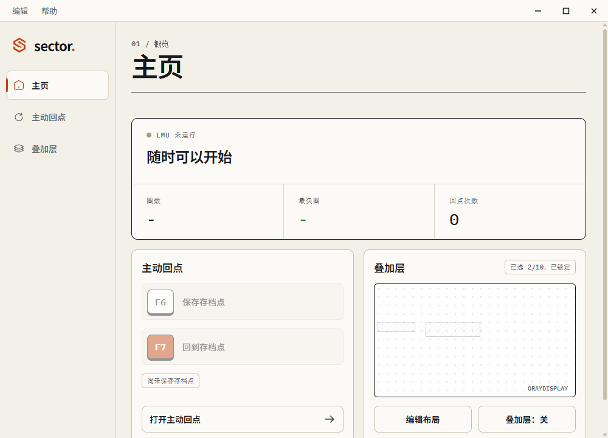
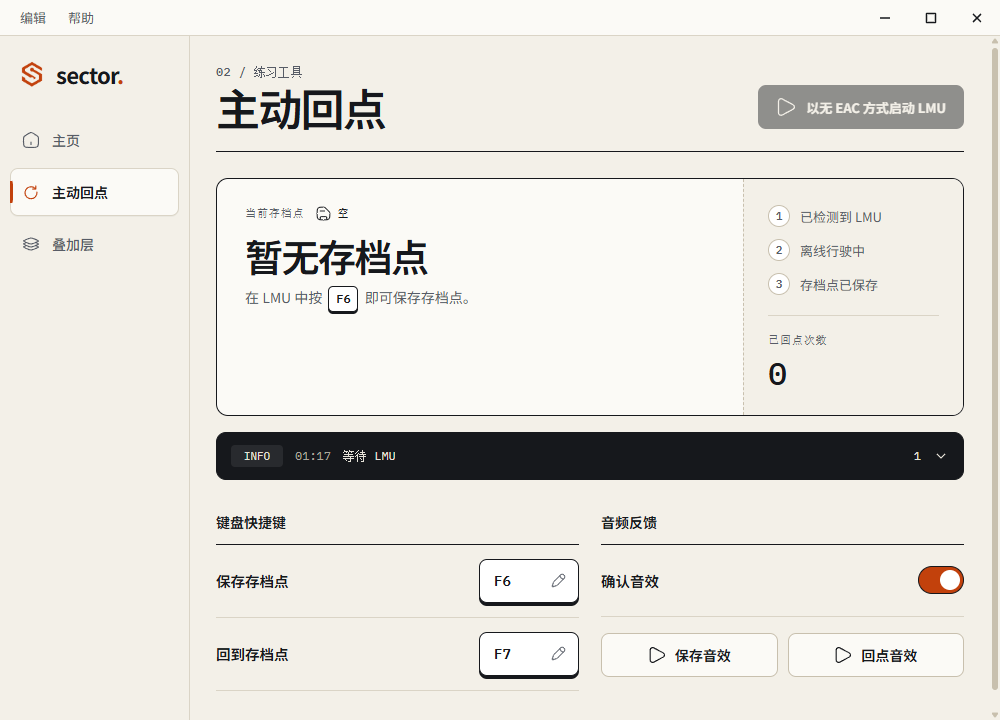
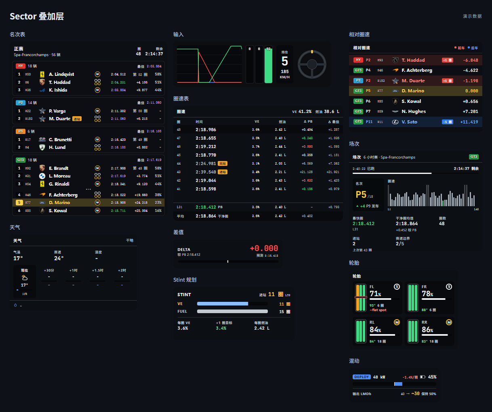
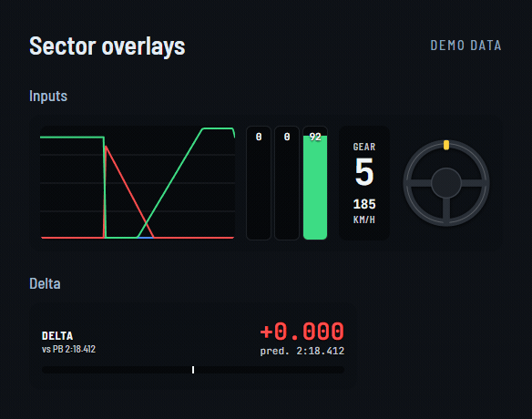
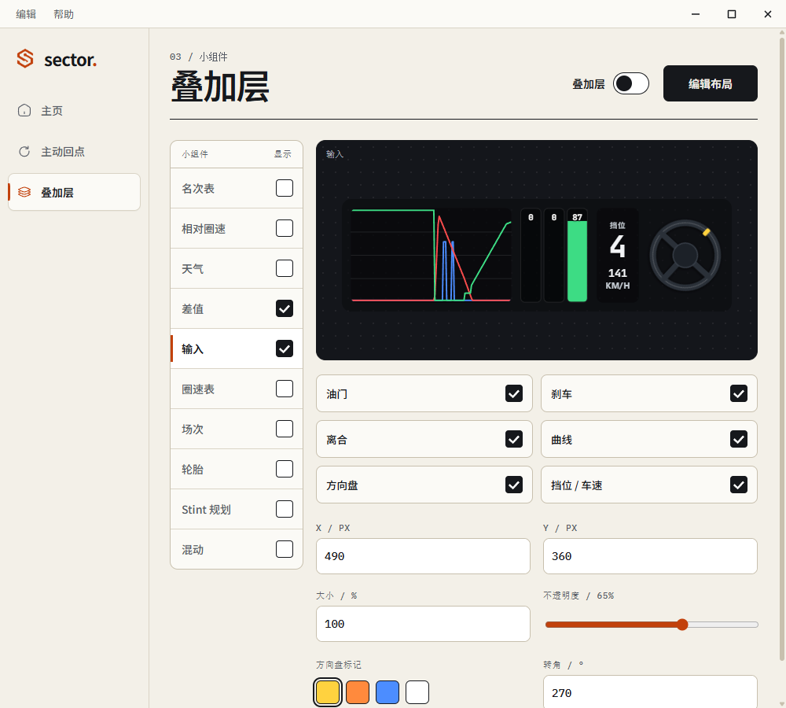
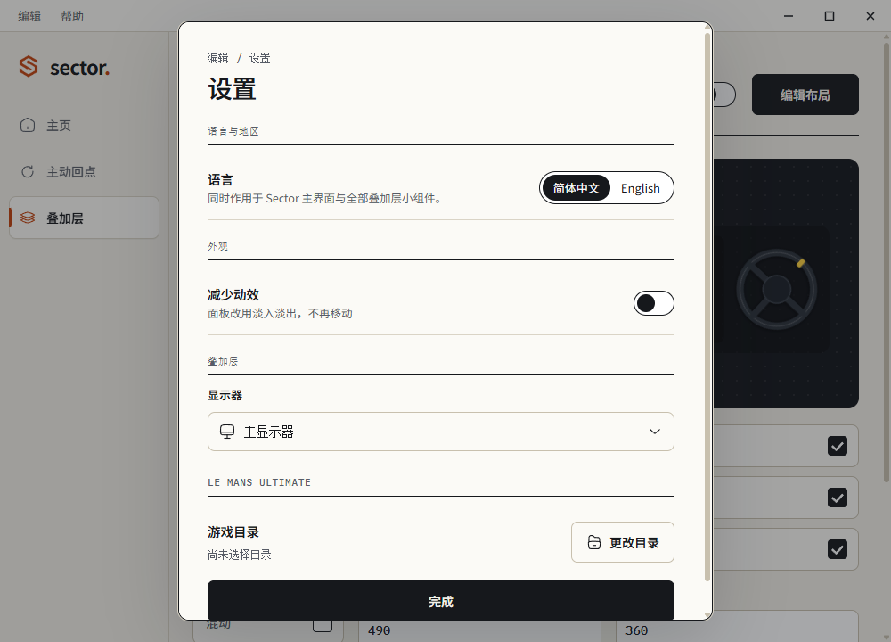

  

<h1 align="center">Sector</h1>

  
  &nbsp;&nbsp;&nbsp;
  
  &nbsp;&nbsp;&nbsp;
  
  &nbsp;&nbsp;&nbsp;
  

  <a href="README.md">English</a>

**练车，也把有用的比赛信息留在眼前。**

**主动回点是实验性功能。** 可下载的版本和各自的已知限制见 [Releases 页面](https://github.com/sector-lmu/Sector/releases)。`dev` 分支里可能有还没发布成下载包的改动。

Sector 是给 **Le Mans Ultimate** 用的 Windows 应用。在赛道上存一个点，随时回到那里，反复练一个弯或一段路。也可以在游戏画面上挂各种小组件，看名次、圈速、踏板输入等等。

  <a href="https://github.com/sector-lmu/Sector/releases"><strong>下载 Windows 版 Sector</strong></a>
  &nbsp;&nbsp;&nbsp;
  <a href="docs/README.md">用户指南</a>
  &nbsp;&nbsp;&nbsp;
  <a href="https://github.com/sector-lmu/Sector/issues">报告问题</a>

## 📥 安装 Sector

需要 **64 位 Windows**，以及已经装好的 **Le Mans Ultimate**。

1. 打开 [Releases 页面](https://github.com/sector-lmu/Sector/releases)，在 **Assets** 里找名为 `Sector-<version>-win-x64.zip` 的 Windows 下载包。
2. 下载这个 ZIP，在 Windows 里右键选**全部解压缩**。
3. 打开解出来的文件夹，双击 **`Sector.exe`**。

Sector 直接在它自己的文件夹里运行：没有安装程序，也不用另外装什么软件。整个文件夹要放在一起；你可以给 `Sector.exe` 建一个桌面快捷方式。

请下 **Windows app ZIP**，不是 GitHub 的 **Source code**。不需要下载源码仓库，也不用装 Python、Node.js 或开发工具。

## 🚦 第一次启动

Sector 会自动找你的 LMU 安装位置。确认它找到的目录，或者用文件夹选择框自己选。正确的目录里有 `Le Mans Ultimate.exe`。

点**选择目录**会打开 Windows 的文件夹选择框。在你确认一个有效安装之前，这个设置窗口不会关掉，按 Escape 或者点外面都跳不过去。

不知道 LMU 装在哪儿的话，在 Steam 库里打开它的**管理 → 浏览本地文件**，把那个文件夹给 Sector 就行。

之后可以看一遍简短的引导。以后想重看，随时走 Sector 顶部菜单的**帮助 → 快速指南**。

要把 Sector 指到另一个 LMU 安装，打开**编辑 → 设置 → Le Mans Ultimate**，选**更改目录**，选中含 `Le Mans Ultimate.exe` 的文件夹。Sector 会校验并记住这个选择。

**主页**标签页把车局、存档点和叠加层布局放在一起。在**主动回点**里点**以无 EAC 方式启动 LMU**，它会从你确认过的安装目录启动游戏。如果检测到 EAC，Sector 会给出警告，并禁用保存/回点和它们的快捷键。用这个按钮重开之前先关掉 LMU。Steam 要能正常使用。LMU 已经在跑时这个按钮才会显示。

在主页里用**保存存档点**或**回到存档点**执行对应动作。键位在**主动回点**里改。用**编辑布局**和**叠加层开/关**管理小组件。每次更新改了什么，看**帮助 → 更新日志**。车局里的数字跟着游戏更新，拿不到的值显示 `-`。

**主动回点需要 LMU 的离线模式。** 在游戏里选 **Offline**，再开一场 **Practice**。而且 LMU 必须**不带 Easy Anti-Cheat（EAC）**启动。

Sector 会检查装好的游戏是否兼容。如果某次 LMU 更新还不支持，主动回点会拒绝连接；去检查有没有更新的 Sector 版本。

## 🏁 主动回点

主动回点让你反复跑同一段路，而不用整圈开回去。**存档点**就是存下来的一个点，包含车当时的位置、朝向和驾驶状态。

1. **不带 Easy Anti-Cheat（EAC）**启动 LMU，选 **Offline** 模式。
2. 加载一场 **Practice**，进入 **DRIVE**，等 Sector 连上。
3. 车况健康时切回游戏，在起点按 **F6**，等**存档点已保存**出现再继续。
4. 接着往前开，想重来时按 **F7** 回到那个存档点。

回来的车带着存下的驾驶状态，包括当时的速度。再存一次会替换掉存档点，所以你可以换一段来练。如果 Sector 提示存档点已不可用，重新存一个。

存档点属于当前这台车和这场车局，不是重启游戏后还能读回来的练习文件。换车局、或者让 LMU 重新生成你的车，都可能让存档点失效。

### 车辆受损后回点

要在车况健康时保存。撞击结束之后，回到那个存档点，就能恢复支持的那部分物理和车身状态。可见的前部车身修复在 Mercedes-AMG LMGT3 上验证过。损伤恢复仍是实验性的：其它车型和碰撞类型还要继续测。爆胎修复在 Peugeot 9X8 上验证过，其它车型还在测。脱落部件不支持。

如果保存或回点被拒绝，读一下 Sector 里的提示。如果它没法接受一个健康车况的存档点，修好车，或者重开一场 Practice。

展开存档点卡片下面的**回点日志**可以看最近的状态消息。用**错误与警告**缩小范围，或者用**导出诊断文件**存一份报告用来求助。屏幕上的列表只覆盖本次运行；诊断导出还会带上最近存下的日志。

### 换键和音效

打开**主动回点**，点你想改的那个键，然后在键盘上按新的键。别选 LMU 里已经分配给某个动作的键。在游戏里用之前，两个键都要松开。

确认音效会告诉你保存或回点成功了，还是请求被拒绝了。在同一页打开**确认音效**，再用**保存音效**或**回点音效**试听。

查看主动回点设置

## 📊 叠加层

叠加层就是浮在游戏画面上的小组件。挑你想一直看到的信息：

叠加层用的是 LMU 的公开遥测接口，跟主动回点互不相干，带着 EAC 跑在线车局也能用。正常从 Steam 启动 LMU，打开你要的小组件就行。在线时主动回点仍然不可用。这条新的连接方式本地测试通过了，还没在真实在线比赛中验证。

*小组件预览用的是演示数据。*

| 小组件 | 显示什么 |
| --- | --- |
| **名次表** | 名次、组别、轮胎配方和可用的虚拟电量；附近对手留在你所在组别的分区里 |
| **相对圈速** | 附近的车辆和估算差距 |
| **天气** | 能拿到的天气信息 |
| **差值** | 当前这圈跟参考圈比差多少 |
| **输入** | 踏板、转向、挡位和速度 |
| **圈速表** | 圈速历史和可用的用量信息 |
| **场次** | 场次与玩家信息 |
| **轮胎** | 轮胎寿命、胎面温度、配方、轮胎圈数和平斑估算 |
| **Stint 规划** | 估算剩余圈数、进站圈和油量/电量消耗 |
| **混动** | 电量、电功率、放出/回收状态和学到的曲线建议 |

### 动起来的小组件

看这个演示里踏板、转向、挡位和圈速差距的变化。

### 调成你自己的样子

打开**叠加层**，启用你要的小组件，再把**叠加层**总开关打开。用**编辑布局**移动和缩放它们，摆好了选**锁定布局**。锁定之后，鼠标点击会穿过去落到游戏里。

每个小组件都有自己的选项。可以改大小和透明度，藏掉某些列或厂商标志，去掉像离合输入这样的元素。要选显示在哪块屏上，打开**编辑 → 设置 → 叠加层**。

在列表里选中一个小组件，就能调它的 **X**、**Y** 和**大小**。拖**不透明度**滑块会立刻看到变化。在**输入**里启用方向盘，就能选**轮圈标记**颜色、调旋转范围。厂商标志里有 Genesis，游戏给出 GMR-001 这个名字时也能认出来。

轮胎显示四个轮子，可以挑显示哪些读数，并设定温度的颜色区间。Stint 规划有一个消耗平均窗口和一点圈数余量。它的估算要在 Sector 记录到完整的干净圈之后才有；未知读数显示 `-`。

查看应用设置

界面语言在**设置 → 语言**里切换，默认简体中文，也可以切回 English；主界面和所有小组件会一起变。

LMU 请用**窗口化或无边框模式**。实时小组件只在你处于车局、并且游戏在前台时出现。暂停、离开游戏窗口或者遥测断了，它们会隐藏；实时数据回来后再次出现。按 F7 回点期间，Sector 会保留最后一帧，直到恢复后那台车的数据到达。

刷新率跟着给叠加层指定的那块屏走，没有单独的刷新率选项。实际的数据更新还取决于 LMU 给什么。估算值带 `~`，包括计时更新之间的差距和平斑检测。Stint 和混动的建议要先观察到足够的圈数才会出现；它们不会替你改车的设置。

摆布局的时候，编辑器可以用示例数据显示。游戏不提供的实时值会显示 `-`。在线车局里对手信息可能更少；缺的读数就一直空着，名次和计分差距用 LMU 给的数据算。

## 让 Sector 在后台运行

关窗口时你有三个选择：

- **在后台运行**：窗口藏起来，Sector 和它的快捷键继续工作。
- **退出 Sector**：关掉应用，所有功能停止。
- **取消**：回到窗口。

要把 Sector 叫回来，点 Windows 时钟旁通知区域里的图标，或者再启动一次 `Sector.exe`。

## 更新 Sector

1. 用**退出 Sector**关掉正在跑的版本，别把它留在后台。
2. 从 [Releases](https://github.com/sector-lmu/Sector/releases) 下载新的 Windows ZIP。
3. 解压到一个新文件夹，启动里面的 `Sector.exe`。
4. 桌面快捷方式还指着旧版本的话，更新一下。

键位分配、叠加层布局和首次启动的选择都会保留。每个包里的文件要放在一起；不要只把新的 EXE 拷到旧安装上。如果主动回点要你重启 LMU，就在存新存档点之前先重启。

### Sector 1.0.0

下载 [Windows 免安装包](https://github.com/sector-lmu/Sector/releases/tag/v1.0.0)。1.0.0 把当前的桌面与叠加层功能带进了 `prod`。主动回点和损伤修复仍是实验性的。升级后请重启 LMU，并在车况健康时存一个新的存档点。

- 为已映射的独立轮毂悬挂提供实验性的车轮重新安装。实车验证还没做；不支持的悬挂形式仍然被拦住。
- 悬挂故障和部件脱落故障给出各自独立的诊断消息。
- 检测到反作弊时立即给出 EAC 警告并禁用回点控件。
- 针对判罚报告补充诊断信息。赛道边界（track limits）的问题还在排查。
- 主动回点和叠加层编辑器界面更宽。
- 可以在设置里更改 LMU 安装目录。
- 通过**帮助 → 报告问题**打开 GitHub 问题页。
- 浅色界面配橙色点缀，字体和菜单都更清楚了。
- 不透明度滑块实时生效，方向盘标记可选颜色。
- 支持 Genesis 厂商标志。
- 橙色 Sector 标志和更易读的启动动画。动画只在刚打开应用时播放，从后台回来不播。

车轮重新安装、按 F7 之后的圈速计时、以及在线叠加层都还需要实车验证。已测过的场景和当前限制见[验证记录](docs/TEST_RESULTS.md)。

完整的版本历史在应用里的**帮助 → 更新日志**。[Release 说明](https://github.com/sector-lmu/Sector/releases)列出已发布的下载包和它们当前的限制。

## 需要帮助？

设置、常见问题和更新方法见[用户指南](docs/README.md)，应用里也可以打开**帮助 → 快速指南**。

提 bug 时请带上 Sector 版本、LMU 版本、车型和赛道、应用的原文提示，以及复现步骤。显示问题请附截图和你的显示器配置。问题请报到 [GitHub Issues](https://github.com/sector-lmu/Sector/issues)。**帮助 → 报告问题**会在浏览器里打开新建 issue 的页面，报告由你自己检查并提交。

先复现问题，然后打开**帮助 → 导出诊断文件**，选**保存诊断文件**。把生成的 JSON 文件跟报告一起发。里面有最近的文本日志、回点错误详情、应用与显卡版本，以及能拿到的车型/赛道信息。Windows 用户目录名会被打码，也不会自动上传任何内容。升级到这个诊断版本后请重启 LMU。

## 支持 Sector

如果 Sector 对你有用，给仓库点个星。也可以用 **[在 Ko-fi 上自愿打赏](https://ko-fi.com/illandiii)** 支持它的开发。

Sector 是独立项目，与 Le Mans Ultimate 没有关联。它自己的代码和文档用 [MIT 许可证](LICENSE)；第三方素材保留[各自的条款与署名](src/ui/electron/THIRD_PARTY_NOTICES.md)。

想参与开发？看[开发者指南](CONTRIBUTING.md)。
